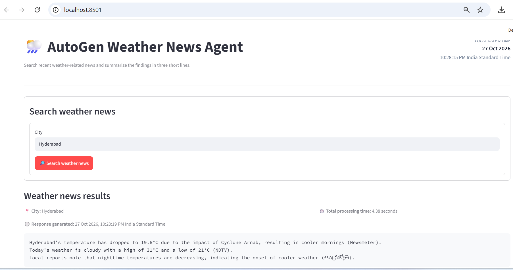

# Weather News Agent — UI update

Replace the existing `app.py` with this version to show:
- Current local date/time in the top-right header.
- Response generated timestamp above the answer.
- Total elapsed time for the full agent run.
- Existing three-line response and expandable AutoGen trace.

The elapsed time measures the entire agent run, including DuckDuckGo search and LLM processing; it does not isolate laptop performance. The top-right clock updates when Streamlit reruns the app. Response timestamp is recorded after the run completes. Neither timestamp is the news article publication time.

## Apply the update
Copy this `app.py` into your existing `weather-news-agent` folder, replacing the old file. Keep `weather_news.py`, `.env`, and `requirements.txt` unchanged.

Restart the app:
```bat
Ctrl+C
python -m streamlit run app.py
```
## Application Output

