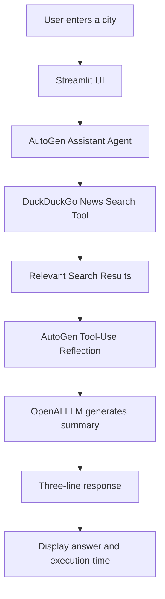

# 🌦️ Weather News Agent — AutoGen + DuckDuckGo

An AI-powered weather news assistant built with **Microsoft AutoGen, OpenAI, DuckDuckGo Search, and Streamlit**. Enter a city to retrieve relevant weather-related news and generate a concise, three-line summary through an AI agent that can call an external search tool.

## 📌 Project Overview

Finding relevant weather news often requires manually searching multiple sources and reviewing lengthy articles. This project demonstrates how an AI agent can use a search tool to gather relevant information and return a short, readable response through a simple user interface.

The application combines tool-enabled AI reasoning with web search, making it a practical demonstration of how an agent can move beyond generating answers from its model knowledge alone.

### Key Features

- **AutoGen Assistant Agent:** Uses Microsoft's AutoGen AgentChat framework to create a tool-enabled AI assistant.
- **DuckDuckGo News Search:** Uses the `ddgs` Python package to search for relevant weather-related news without requiring a separate search API key.
- **Custom Python Tool:** Implements a reusable search function with type hints and a docstring.
- **Tool Execution and Reflection:** Uses `reflect_on_tool_use=True` to let the agent reflect on tool results and formulate a response.
- **Interactive Streamlit UI:** Provides a simple interface for entering a city and viewing the generated answer.
- **Timestamp and Performance:** Displays the response generation time and total processing duration.
- **Secure Configuration:** Loads the OpenAI API key from an environment variable rather than hardcoding credentials.
- **Concise Output:** Presents the final response in exactly three short lines.

## 🖥️ Application Output

The interface allows users to enter a city, initiate a search, and review the generated weather news response, along with the execution duration and agent trace.


## 🏗️ Architecture



### Execution Flow

1. **User input:** The user enters a city, such as Chennai.
2. **Agent initialization:** AutoGen creates an assistant agent configured with an OpenAI model and the registered search tool.
3. **Tool selection:** The agent determines when to use the available search function to retrieve relevant news.
4. **Search execution:** The custom Python function queries DuckDuckGo and returns search results.
5. **Reflection and synthesis:** The agent uses the tool results to prepare a concise response.
6. **Output formatting:** The application displays the response in three short lines.
7. **Performance visibility:** The UI shows the response timestamp and total processing duration.

*Note:* Search results depend on the search engine's available content. This application retrieves weather-related news; it does not independently measure current weather conditions or provide a guaranteed live forecast.

## 🧰 Technology Stack

| Technology | Purpose |
|---|---|
| Python | Core application and search-tool implementation |
| Microsoft AutoGen AgentChat | Agent creation, message handling, and tool execution |
| AutoGen OpenAI extension | Connects the agent to an OpenAI model |
| OpenAI model (`gpt-4o-mini`) | Interprets search results and generates the response |
| DuckDuckGo Search (`ddgs`) | Retrieves relevant weather-related news |
| Streamlit | Interactive web interface |
| `python-dotenv` | Loads local environment variables from `.env` |

## 📂 Project Structure

```text
weather-news-agent/
│
├── app.py                 # Streamlit user interface
├── weather_news.py        # AutoGen agent and search-tool logic
├── requirements.txt       # Python dependencies
├── .env.example           # Example environment configuration
├── .env                   # Local API key; do not commit
├── .gitignore             # Excludes secrets and generated files
├── README.md              # Project documentation
└── weather-news-agent-output.png
                           # Application screenshot
```

## ⚙️ Prerequisites

Before running the application, ensure you have:

- Python 3.12 or another Python version supported by the installed dependencies.
- An OpenAI API key with access to the configured model.
- Git, if you want to clone the repository.
- An internet connection for DuckDuckGo searches and OpenAI API requests.

## 🚀 Installation and Setup

### 1. Clone the repository

Open Command Prompt or a terminal:

```cmd
git clone https://github.com/ksmurari1/weather-news-agent.git
cd weather-news-agent
```

### 2. Create a virtual environment

```cmd
python -m venv .venv
.venv\Scripts\activate
```

### 3. Install dependencies

```cmd
python -m pip install --upgrade pip
python -m pip install -r requirements.txt
```

### 4. Configure the OpenAI API key

Copy the example environment file:

```cmd
copy .env.example .env
```

Open `.env` and add your API key using the variable name expected by the application:

```dotenv
OPENAI_API_KEY=your_openai_api_key_here
```

Replace the placeholder with your own key. Do not commit `.env` or publish the key in screenshots, source code, or logs.

### 5. Launch the application

```cmd
python -m streamlit run app.py
```

Streamlit will provide a local URL, typically `http://localhost:8501`. Open that address in your browser if it does not open automatically.

### 6. Try the agent

1. Enter a city, for example, `Chennai`.
2. Click the search or submit button.
3. Wait for the agent to search and process the results.
4. Review the three-line answer, response timestamp, and processing duration.
5. Expand the agent trace, if available, to inspect the tool interaction.

## 🧠 AutoGen Concepts Demonstrated

### 1. Assistant Agent

The assistant is configured with an OpenAI model and a tool that it can use to gather information. This demonstrates how an LLM-based agent can interact with external functions instead of relying solely on its internal knowledge.

### 2. Custom Python Tool

The search function is a Python function registered with AutoGen. Type hints and a docstring describe its inputs and purpose, helping AutoGen understand how the tool should be used.

### 3. Tool Registration

The tool is made available to the agent through its `tools` configuration. The agent can then invoke the function as part of its response-generation process.

### 4. Reflection on Tool Use

The configuration `reflect_on_tool_use=True` enables the agent to use the tool results as part of a follow-up reasoning step to formulate its answer.

### 5. Model Client Lifecycle

The implementation closes the model client after use to help release associated resources.

## 📦 Dependencies

The project's dependencies are defined in `requirements.txt`. They include:

- `autogen-agentchat==0.7.5`
- `autogen-ext[openai]==0.7.5`
- `ddgs`
- `streamlit`
- `python-dotenv`

Use the repository's `requirements.txt` as the source of truth for the exact installed dependency specifications.

## 🔐 Security and Limitations

- **API key:** Keep your OpenAI key in a local `.env` file or another secure environment configuration.
- **Search availability:** Search results can vary depending on location, query, indexing, and service availability.
- **News versus forecasts:** Search results about weather are not equivalent to live meteorological observations or official forecasts.
- **External dependencies:** The application needs internet connectivity for search and model requests.
- **Response quality:** The final answer depends on the relevance of retrieved results and the model's interpretation.
- **Processing time:** Total duration includes the end-to-end operation measured by the application, rather than a separately benchmarked search or model duration.

## 🔮 Potential Enhancements

- Add an official weather API for current conditions and forecasts.
- Display source headlines and links alongside the generated summary.
- Add structured output validation to enforce the three-line response format.
- Introduce retries and clearer error handling for search and API failures.
- Track search time and model-generation time separately.
- Extend the application to support multiple cities and additional news categories.

## 🎯 Learning Outcomes

This project demonstrates practical experience with:

- Building a tool-enabled AI agent using Microsoft AutoGen.
- Connecting an LLM to a custom Python function.
- Retrieving external information through DuckDuckGo search.
- Using tool results to generate a concise answer.
- Building an interactive Streamlit interface for an AI application.
- Managing API credentials and Python dependencies.
- Measuring end-to-end execution duration and documenting an AI workflow.

## 👨‍💻 Author

**Murari Konduru**

Senior BI and Data Visualization Architect | AI, Analytics, and Intelligent Automation

GitHub: [@ksmurari1](https://github.com/ksmurari1)

---

*This repository demonstrates a practical AutoGen agent workflow combining search, tool execution, LLM response generation, and a lightweight user interface.*